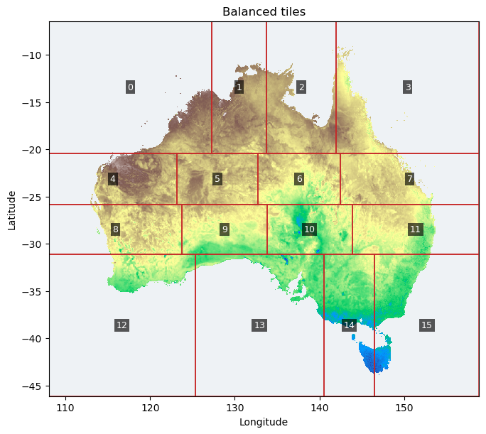

# connectivity: a multi-resolution landscape connectivity algorithm

[](https://github.com/csiro/connectivity/actions/workflows/publish.yml)
[](https://github.com/csiro/connectivity/actions/workflows/github-code-scanning/codeql)
[](https://pypi.org/project/eco-connectivity/)
[](https://pypi.org/project/eco-connectivity/)
[](https://pepy.tech/projects/eco-connectivity)
[](https://doi.org/10.32942/X2S68V)

- [connectivity: a multi-resolution landscape connectivity algorithm](#connectivity-a-multi-resolution-landscape-connectivity-algorithm)
  - [Installation ](#installation-)
    - [Install from PyPI ](#install-from-pypi-)
    - [Install from Source ](#install-from-source-)
    - [Experimental Mac GPU support](#experimental-mac-gpu-support)
    - [Experimental NVIDIA GPU support (CUDA/H100)](#experimental-nvidia-gpu-support-cudah100)
  - [Connectivity Analysis ](#connectivity-analysis-)
    - [Connected Habitat (Connectedness) ](#connected-habitat-connectedness-)
      - [Optional resistance surface](#optional-resistance-surface)
    - [PARC-Connectedness ](#parc-connectedness-)
    - [Bioclimatic Ecosystem Resilience Index (BERI) ](#bioclimatic-ecosystem-resilience-index-beri-)
  - [Running Analysis with Tiles ](#running-analysis-with-tiles-)
  - [Citation](#citation)
      
A multi-resolution landscape connectivity algorithm for calculating ***Habitat Connectivity (Connected-Habitat)***, ***PARC Connectedness*** and the ***Bioclimatic Ecosystem Resilience Index (BERI)***. It combines habitat condition, least-cost paths and dispersal kernels to estimate how much surrounding habitat is accessible across different dispersal scales. The algorithm retains fine spatial detail near each focal cell and represents more distant areas at progressively coarser resolutions, using raster overview layers generated on the fly to make large-landscape analyses efficient. PARC Connectedness additionally incorporates protected-area coverage, while BERI incorporates current and future climate-related compositional similarity to assess ecosystem resilience under climate change. Implemented in Rust with a Python interface, the framework supports biodiversity monitoring and conservation planning. See [Valavi et al. (2026)](https://doi.org/10.32942/X2S68V) for the full method.

## Installation <a name="install"></a>     
### Install from PyPI <a name="pypi"></a>     
The package is published on PyPI as `eco-connectivity` (NOTE: `pip install connectivity` installs an unrelated package):

```bash
pip install eco-connectivity
```

The import name is still `connectivity`:

```python
from connectivity import connectedness, beri
```

### Install from Source <a name="source"></a>     

To build the latest development version from the [GitHub repository](https://github.com/csiro/connectivity), install [Rust](https://www.rust-lang.org/tools/install) first, then run:

```bash
git clone https://github.com/csiro/connectivity.git
cd connectivity
pip install .
```

### Experimental Mac GPU support

CPU execution remains the default. To enable the experimental CubeCL native
Metal backend, build a wheel from source on macOS 15 or newer with a
Metal 3-compatible GPU and Rust 1.95 or newer:

```bash
rustup toolchain install 1.95.0 --profile minimal
pip install maturin
RUSTUP_TOOLCHAIN=1.95.0 maturin build --release --features metal
```

Install the exact wheel path printed by Maturin:

```bash
pip install --force-reinstall /path/to/the/built/wheel.whl
```

An ordinary `maturin build --release` or `pip install .` builds the CPU backend.
The `metal` feature is selected at build time; requesting a device at runtime
cannot add it to an existing installation. Published wheels are not assumed to
include this experimental feature.

Pass `device="metal"` to `connectedness()` or `beri()` to opt in:

```python
from connectivity import connectedness, example_data_path

connd = connectedness(
    condition_file = example_data_path("site_condition"),
    device = "metal",
)
```

The prototype runs adjusted and intact shortest-path searches in GPU batches
that span raster rows, with a per-worker edge limit to bound memory use. Each
batch uses one input upload and one combined result readback.
Graph construction, edge-cost calculation and indicator calculations stay on
the CPU, preserving the CPU edge costs for comparison. Performance depends on
the graph size and transfer overhead; this prototype does not promise a speedup.
Compare GPU results against the default `device="cpu"` for the same inputs.
If Metal was not compiled in or a compatible GPU cannot be initialized, the
request raises a clear error before raster data is read. It never silently
changes the selected device.

### Experimental NVIDIA GPU support (CUDA/H100)

The optional CUDA backend targets NVIDIA GPUs, including H100, on Linux or
Windows. For an H100 Linux machine, install Rust 1.95 or newer and load your
site's CUDA Toolkit 12.1 or newer environment, with a compatible NVIDIA driver.
The selected CubeCL CUDA C++ compiler uses NVRTC and CUDA headers at runtime,
so these must also be available on the compute node. Set `CUDA_PATH` to the
toolkit directory; if your module sets only `CUDA_HOME`, use
`export CUDA_PATH="$CUDA_HOME"`. Ensure its NVRTC libraries are on the runtime
library search path. The H100 compiler target is `sm_90a`, requiring CUDA 12.1
or newer. The first build also needs a C++ compiler and access to CubeCL's LLVM
bundle download or a pre-populated build cache. Make `nvcc` available while
building so the bindings match the toolkit used on the compute node. See the
[CubeCL setup requirements](https://burn.dev/books/cubecl/getting-started/installation.html)
and [NVIDIA Hopper compatibility guide](https://docs.nvidia.com/cuda/hopper-compatibility-guide/).

Build from the repository checkout in the environment where you will run it:

```bash
nvidia-smi
nvcc --version
rustup toolchain install 1.95.0 --profile minimal
pip install maturin
RUSTUP_TOOLCHAIN=1.95.0 maturin build --release --features cuda
pip install --force-reinstall /path/to/the/built/wheel.whl
```

Replace the wheel path with the exact path printed by Maturin. Ordinary builds
and published wheels are not assumed to include CUDA. Select it explicitly:

```python
import os
from connectivity import connectedness, example_data_path

result = connectedness(
    condition_file=example_data_path("site_condition"),
    device="cuda",
    n_threads=int(os.environ.get("SLURM_CPUS_PER_TASK", "8")),
)
```

`beri()` accepts the same device argument. Initialization failures raise an error
before raster data is read; CPU remains the default. The backend uses the first
GPU visible to the process. On Slurm, request an H100 GPU allocation and preserve
the scheduler's `CUDA_VISIBLE_DEVICES` setting. Outside a scheduler, set that
variable before starting Python to select a physical GPU. Each process uses one
GPU; multiple GPUs are not used automatically.

On an allocated H100 compute node, check device availability and then run the
CPU/GPU parity tests from the checkout:

```bash
python -c 'from rust_conn import validate_device; validate_device("cuda")'
python -m unittest discover -s tests -p test_device.py
cargo +1.95.0 test --features cuda cuda_ -- --ignored
```

For Slurm, [examples/h100.slurm](examples/h100.slurm) runs the Python device and
parity checks without building on the compute node. Adjust its GPU resource,
account and partition for your site, then submit from the checkout with the
built Python environment activated and CUDA loaded:

```bash
sbatch examples/h100.slurm
```

The job inherits your environment and preserves Slurm's GPU visibility setting.
It validates the installation and results; it is not a performance benchmark.

The availability check must succeed: hardware parity tests skip when no GPU
backend is available. Compare results and full analysis runtime against
`device="cpu"` on your actual rasters. Graph construction and indicator
calculations still run on CPU, and GPU transfer overhead can outweigh routing
savings. H100 correctness and performance require validation on that hardware.

## Connectivity Analysis <a name="analysis"></a>     
Resolve the bundled example paths once so they can be reused throughout the
analysis:

```python
from connectivity import beri, connectedness, example_data_path, resolution_info

condition_file = example_data_path("site_condition")
pa_file = example_data_path("pa_proportion")
current_file = example_data_path("transgrids/1990")
future_files = [
    example_data_path("transgrids/IPS50_45"),
    example_data_path("transgrids/GFD50_85"),
]
```

To bound the spatial extent of the connectivity calculation, the algorithm limits how far it searches across neighboring cells in the condition raster. The approximate one-sided search reach is computed as:
`max_reach = outer_window * max(levels) * resolution`. For example, with a 1 km resolution raster, a max-level of 32, and an `outer_window` of 11, the resulting search reach is:
      
```text
distance = outer_window × max_level × resolution
         = 11 × 32 × 1 km
         = 352 km  
```    

Use `resolution_info()` to preview how candidate `levels` will change raster
dimensions and approximate search reach before running the analysis:

```python
resolution_info(condition_file, outer_window=9)
```

```text
File: .../connectivity/data/site_condition.tif
Base raster: 588 x 516 cells (303.41K total)
Base resolution: 0.008333 degrees
CRS: EPSG:4326
Bands: 1
Data type(s): float32
Nodata: -9999.0
Outer window: 9
Small-dimension warning threshold: < 16 cells
Distance note: approximate km values use centre latitude -41.550

Candidate internally generated levels:
  Level    Width   Height      Cells   % base           Resolution            Reach     Reach km  Note
      1      588      516    303.41K 100.000%     0.008333 degrees    0.075 degrees     8.349 km
      2      294      258     75.85K  25.000%      0.01667 degrees     0.15 degrees      16.7 km
      4      147      129     18.96K   6.250%      0.03333 degrees      0.3 degrees      33.4 km
      8       74       65      4.81K   1.585%      0.06667 degrees      0.6 degrees     66.79 km
     16       37       33      1.22K   0.402%       0.1333 degrees      1.2 degrees     133.6 km
     32       19       17        323   0.106%       0.2667 degrees      2.4 degrees     267.2 km
     64       10        9         90   0.030%       0.5333 degrees      4.8 degrees     534.3 km  small grid; review
    128        5        5         25   0.008%        1.067 degrees      9.6 degrees     1.07K km  small grid; review
    256        3        3          9   0.003%        2.133 degrees     19.2 degrees     2.14K km  small grid; review
    512        2        2          4   0.001%        4.267 degrees     38.4 degrees     4.27K km  small grid; review
```

The default `window_mode="circular"` uses source-centered circular annuli with
fractional area/count support at annulus boundaries. The
`window_mode="square"` option uses the same source-centered fractional
construction with square annuli. These modes change indicator values, so
compare outputs only between runs that use the same window mode.


Each coloured neighbourhood represents a different raster aggregation level.
Fine levels capture nearby cells at higher resolution, while coarser levels
extend the search over larger distances. Their contributions are combined into
a single graph, in which the least-cost path from the focal cell is calculated
for each aggregated cell.
See [Valavi et al. (2026)](https://doi.org/10.32942/X2S68V) for the full method.

### Connected Habitat (Connectedness) <a name="conn"></a>    

To compute connected-habitat (or plain connectedness), you only need a habitat condition raster. Use `option` argument to generate the connected-habitat from connectedness and input condition with:    
1. `connectedness`
2. `connectedness * condition`
3. `sqrt(connectedness * condition)` — geometric mean (default)

```python
connd = connectedness(
    condition_file = condition_file,
    lambdas = [2, 20, 200],
    max_cost = 2.0, 
    window_size = 5, 
    outer_window = 11,
    window_mode = "circular",
    levels = [2, 4, 8, 16, 32], 
    option = 3,
    filename = "./results/connected_habitat.tif"
)
```


#### Optional resistance surface

By default the habitat condition raster does double duty: it weights how costly each cell is to
move through **and** supplies the habitat value used in the indicator. Pass an optional
`resistance_file` to **decouple** these two roles. The resistance raster (values in `[0, 1]`,
higher = harder to cross, scaled with `resistance_scale`) then drives **only** the least-cost path
traversal, while condition still supplies the habitat value:

```python
connd = connectedness(
    condition_file = condition_file,
    resistance_file = resistance_file,   # optional; decoupled movement-cost surface
    resistance_scale = None,             # divide resistance into [0, 1] if needed
    max_cost = 2.0,
    window_mode = "circular",
    levels = [2, 4, 8, 16, 32],
)
```

The edge weight becomes `w = (1.0 - max_cost) * (1 - resistance) + max_cost`, so `resistance = 0`
is free (`w = 1`) and `resistance = 1` is the most costly (`w = max_cost`). When `resistance_file`
is omitted, condition is used for traversal as before, and the output is unchanged. Cells valid in
condition but missing a resistance value fall back to condition for traversal and raise a warning,
so the analysis domain is never changed silently. The same `resistance_file` / `resistance_scale`
arguments are available on `beri()`.

### PARC-Connectedness <a name="parc"></a>     
To compute PARC-connectedness, provide both:
* a habitat condition raster, and
* a protected-areas proportion raster.    
     
When `pa_file` (proportion of protected-areas in each cell) is supplied, the function automatically returns PARC-connectedness instead of standard connectedness.

```python
parcc = connectedness(
    condition_file = condition_file,
    pa_file = pa_file,
    lambdas = [2, 20, 200],
    max_cost = 2.0, 
    window_size = 5, 
    outer_window = 11,
    window_mode = "circular",
    levels = [2, 4, 8, 16, 32], 
    filename = "./results/parc_connectedness.tif"
)
```


Use `pixel_coverage()` when you need the proportion of each raster pixel covered
by polygon geometry. The calculation is backed by a performant Rust
implementation:

```python
from connectivity import pixel_coverage

coverage = pixel_coverage(
    "./data/polygons.gpkg",
    condition_file,
)
```

### Bioclimatic Ecosystem Resilience Index (BERI) <a name="beri"></a>    
To compute BERI, you must provide:
* a condition raster
* current GDM transgrids
* one or more future transgrids scenarios (as a list)

```python
beris = beri(
    condition_file = condition_file,
    current_file = current_file,
    future_files = future_files,
    lambdas = [2, 20, 200], 
    max_cost = 2.0, 
    window_size = 5, 
    outer_window = 11,
    window_mode = "circular",
    levels = [2, 4, 8, 16, 32],
    filename = "./results/berri.tif"
)
```


## Running Analysis with Tiles <a name="tiles"></a>    

To run the model using tiles, create a rectangular tile polygon as a GeoDataFrame
and pass it to the `polygon_mask` argument. This limits data loading to only the
portion required for the tile, i.e. the output core plus the internally buffered
neighborhood.

Use `make_tile()` to generate non-overlapping output-core tiles whose internal
boundaries align with the coarsest aggregation level. This is preferred over
creating overlap-expanded tile polygons externally. Be sure to set
`closed_border = False` (the default) so that neighborhood information is
included around each tile core.

```python
from connectivity import connectedness, make_tile

levels = [2, 4, 8, 16, 32]

tile_id = 0
tile_poly = make_tile(
    raster_file = condition_file,
    nrows = 4,
    ncols = 4,
    tile_id = tile_id,
    align_to = max(levels),
)

connd = connectedness(
    condition_file = condition_file,
    polygon_mask = tile_poly,
    closed_border = False,
    margin_px = 32,
    lambdas = [2, 20, 200],
    max_cost = 2.0, 
    window_size = 5, 
    outer_window = 11,
    window_mode = "circular",
    levels = levels, 
    option = 1,
    filename = f"./results/connected_habitat_tile_{tile_id}.tif"
)
```

For large, uneven workloads, use balanced tiles:

```python
tile_poly = make_tile(
    raster_file = condition_file,
    nrows = 4,
    ncols = 4,
    tile_id = tile_id,
    align_to = max(levels),
    balanced = True,
    io_weight = 0.1,
)
```
<!--  -->


Balanced tiling uses a deterministic raster-mask cost estimate while preserving
the same `align_to` boundary alignment. It is useful for global rasters where
some tiles contain mostly ocean or nodata and others contain many valid land
pixels. Use `balanced = False` (the default) when equal aligned tiles are enough.
When `balanced = False`, `io_weight` is ignored.

## Citation
To cite `connectivity` library in publications and reports, please use:

Valavi, R., Mokany, K., Ware, C., Vickers, M., Giljohann, K. M., & Ferrier, S. (2026). **A scalable multi-resolution framework for connectivity-based biodiversity indicators**. *EcoEvoRxiv*. [https://doi.org/10.32942/X2S68V](https://doi.org/10.32942/X2S68V)

[Back to top!](#connectivity-a-multi-resolution-landscape-connectivity-algorithm)
