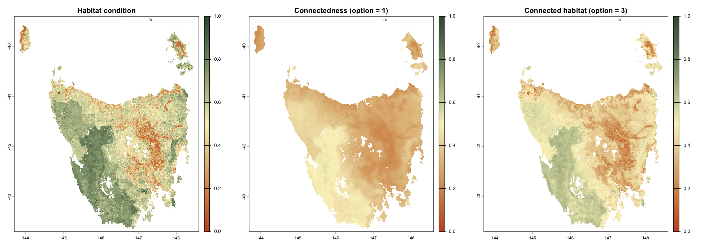
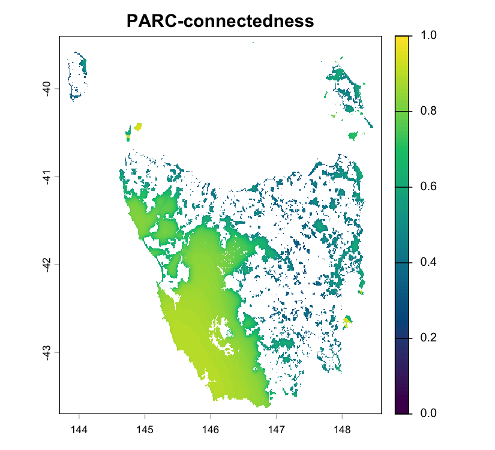
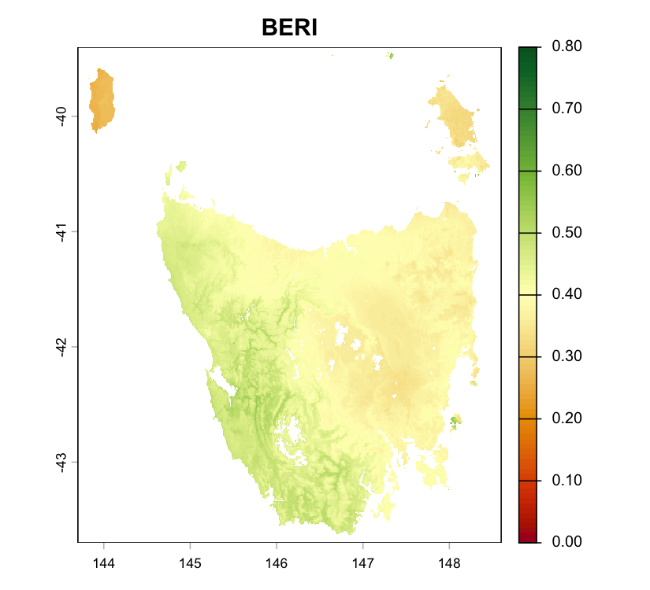

# connectivity: multi-resolution landscape connectivity in R

[](https://github.com/csiro/connectivity/actions/workflows/r-cmd-check.yml)
[](https://www.r-project.org/)
[](https://doi.org/10.32942/X2S68V)

- [Installation](#installation)
  - [Install from GitHub](#install-from-github)
  - [Build a source archive](#build-a-source-archive)
- [Connectivity analysis](#connectivity-analysis)
  - [Connected Habitat (connectedness)](#connected-habitat-connectedness)
    - [Optional resistance surface](#optional-resistance-surface)
  - [PARC-connectedness](#parc-connectedness)
  - [Bioclimatic Ecosystem Resilience Index (BERI)](#bioclimatic-ecosystem-resilience-index-beri)
- [Running analysis with tiles](#running-analysis-with-tiles)
- [Citation and scientific references](#citation-and-scientific-references)
- [Acknowledgements and licence](#acknowledgements-and-licence)

An R package for calculating **Connected Habitat** (a.k.a. connectivity-adjusted
condition), the **Protected Area Connectedness Index (PARC-connectedness)** and
the **Bioclimatic Ecosystem Resilience Index (BERI)**. It combines habitat
condition, least-cost paths and dispersal kernels to estimate how much
surrounding habitat is accessible across dispersal scales. Fine spatial detail
is retained near each focal cell, while progressively coarser grids represent
more distant areas, making large-landscape analyses efficient.
PARC-connectedness incorporates protected-area coverage; BERI incorporates
current and future climate-related compositional similarity to assess ecosystem
resilience under climate change. The package uses `terra` for spatial input and
output and the [`connectivity-core`](https://docs.rs/connectivity-core) Rust
engine, which it shares with the Python package
[`eco-connectivity`](https://pypi.org/project/eco-connectivity/). See
[Valavi et al. (2026)](https://doi.org/10.32942/X2S68V) for the full method.

## Installation

The package is not yet on CRAN. Installing from source needs **R >= 4.2** and
**Rust >= 1.86** with Cargo, for example from [rustup](https://rustup.rs/).
Windows also needs the Rtools version matching R and the Rust GNU target
(`rustup target add x86_64-pc-windows-gnu`).

### Install from GitHub

Install the development version from the
[GitHub repository](https://github.com/csiro/connectivity) with `pak`:

```r
# install.packages("pak")
pak::pak("csiro/connectivity/r/connectivity")
```

or with `remotes`:

```r
# install.packages("remotes")
remotes::install_github("csiro/connectivity", subdir = "r/connectivity")
```

Cargo downloads the Rust dependencies, including the published
`connectivity-core` crate, while the package compiles. Add
`build_vignettes = TRUE` to `install_github()` to build the Tasmania vignette
too; this requires Pandoc, `knitr` and `rmarkdown`.

### Build a source archive

To install without network access, or to prepare a CRAN-style source package,
build an archive that vendors the locked Rust dependencies. Preparation needs
access to the Rust registry or a populated Cargo cache:

```r
install.packages(c("terra", "rextendr", "knitr", "rmarkdown"))
```

```sh
git clone https://github.com/csiro/connectivity.git
cd connectivity
Rscript r/connectivity/tools/build-source.R /tmp/connectivity-r-build
R CMD INSTALL /tmp/connectivity-r-build/connectivity_*.tar.gz
```

Use a fresh output directory for the archive. The R package has its own version
and dependency lock and builds against the published `connectivity-core`
release, so local edits to the repository's Rust core do not affect R builds.

## Connectivity analysis

Inputs may be raster filenames or `terra::SpatRaster` objects, and each
indicator returns a georeferenced single-layer `SpatRaster`. Locate the bundled
Tasmania example rasters once so they can be reused throughout the analysis:

```r
library(connectivity)
library(terra)

data_dir <- system.file("extdata", package = "connectivity")
condition_file <- file.path(data_dir, "site_condition.tif")
pa_file <- file.path(data_dir, "pa_proportion.tif")
current_file <- file.path(data_dir, "transgrids", "1990.tif")
future_files <- file.path(
    data_dir, "transgrids", c("IPS50_45.tif", "GFD50_85.tif")
)
condition <- rast(condition_file)
```

Condition and protected-area proportions must be single-layer rasters with
values in `[0, 1]`; missing condition cells are excluded. Use `scale = 100` for
condition stored as percentages, or `scale = c(100, 100)` to scale both
condition and protected fractions in `connectedness()`. Auxiliary rasters must
share the condition raster's CRS, resolution and pixel grid and cover the
analysis window; they are not resampled automatically. Supply a valid CRS;
projected units are converted internally, and `lambdas` always uses kilometres.

To bound the spatial extent of the calculation, the algorithm limits how far it
searches across neighbouring cells. The approximate search reach is
`outer_window * max(levels) * resolution`. For example, with a 1 km raster, a
maximum level of 32 and an `outer_window` of 9:

```text
reach = outer_window × max_level × resolution
      = 9 × 32 × 1 km
      = 288 km
```

Use `resolution_info()` to preview how candidate `levels` change raster
dimensions and approximate search reach before running the analysis:

```r
resolution_info(condition_file, outer_window = 9)
```

```text
File: .../connectivity/extdata/site_condition.tif
Base raster: 588 x 516 cells (303.41K total)
Base resolution: 0.008333 degrees
CRS: EPSG:4326 (WGS 84)
Bands: 1
Data type(s): FLT4S
Nodata: -9999
Outer window: 9
Small-dimension warning threshold: < 16 cells
Distance note: approximate km values use centre latitude -41.550

Candidate internally generated levels:
Level Width Height   Cells   % base       Resolution         Reach Reach km               Note
    1   588    516 303.41K 100.000% 0.008333 degrees 0.075 degrees 8.349 km
    2   294    258  75.85K  25.000%  0.01667 degrees  0.15 degrees  16.7 km
    4   147    129  18.96K   6.250%  0.03333 degrees   0.3 degrees  33.4 km
    8    74     65   4.81K   1.585%  0.06667 degrees   0.6 degrees 66.79 km
   16    37     33   1.22K   0.402%   0.1333 degrees   1.2 degrees 133.6 km
   32    19     17     323   0.106%   0.2667 degrees   2.4 degrees 267.2 km
   64    10      9      90   0.030%   0.5333 degrees   4.8 degrees 534.3 km small grid; review
  128     5      5      25   0.008%    1.067 degrees   9.6 degrees 1.07K km small grid; review
  256     3      3       9   0.003%    2.133 degrees  19.2 degrees 2.14K km small grid; review
  512     2      2       4   0.001%    4.267 degrees  38.4 degrees 4.27K km small grid; review
```

The table is also returned invisibly as a data frame. Small-grid flags guide
review rather than selecting levels automatically. Indicator calls include
level 1 and require a continuous sequence of powers of two. Both window sizes
must be positive odd integers; `outer_window` is increased to `window_size` if
smaller.

The default `window_mode = "circular"` uses circular annuli with fractional
boundary support; `"square"` uses square annuli. Window mode changes indicator
values, so compare outputs only between runs that use the same mode.


Each coloured neighbourhood represents a different aggregation level. Fine
levels capture nearby cells at higher resolution, while coarser levels extend
the search over larger distances. Their contributions are combined into a
single graph, in which the least-cost path from the focal cell is calculated
for each aggregated cell. See [Valavi et al. (2026)](https://doi.org/10.32942/X2S68V)
for the full method.

### Connected Habitat (connectedness)

To compute Connected Habitat (or plain connectedness), you only need a habitat
condition raster. Scores are averaged across the dispersal bandwidths in
`lambdas`, and `option` selects the output:

1. connectedness
2. `connectedness * condition`
3. `sqrt(connectedness * condition)`, the geometric mean (default)

The call below spells out the default settings, which the following examples
also use:

```r
habitat <- connectedness(
    condition_file = condition_file,
    lambdas = c(2, 20, 200),
    max_cost = 2,
    window_size = 5,
    outer_window = 9,
    window_mode = "circular",
    levels = c(2, 4, 8, 16, 32),
    option = 3
)
plot(habitat, main = "Connected habitat")
```



Results stay in memory unless you pass `filename`; use `overwrite = TRUE` to
replace an existing file and `wopt` for `terra::writeRaster()` options. Files
default to float32. Set `n_threads` to control the number of workers; `NULL`
uses the engine's default.

#### Optional resistance surface

By default the condition raster does double duty: it sets how costly each cell
is to move through **and** supplies the habitat value. Pass `resistance_file` to
decouple the two roles. The resistance raster (higher means harder to cross,
divided by `resistance_scale` if needed) then drives only the least-cost paths,
while condition still supplies the habitat value:

```r
# Illustrative surface; replace with an independently prepared resistance raster.
resistance <- 1 - condition
habitat_resistance <- connectedness(
    condition_file = condition,
    resistance_file = resistance
)
```

The edge weight becomes `(1 - max_cost) * (1 - resistance) + max_cost`, so
resistance 0 costs 1 and resistance 1 costs `max_cost`. Resistance of 1 or
more, including `Inf`, gives the highest cost. Missing resistance at valid
condition cells falls back to condition with a warning, so the analysis domain
never changes silently. The same arguments are available in `beri()`.

### PARC-connectedness

To compute PARC-connectedness, provide both:

- a habitat condition raster, and
- a protected-area proportion raster.

When `pa_file` is supplied, `connectedness()` returns PARC-connectedness
instead of Connected Habitat:

```r
parc <- connectedness(
    condition_file = condition_file,
    pa_file = pa_file,
    lambdas = c(2, 20, 200),
    max_cost = 2,
    window_size = 5,
    outer_window = 9,
    window_mode = "circular",
    levels = c(2, 4, 8, 16, 32)
)
plot(parc, main = "PARC-connectedness")
```



The calculation uses the maximum of condition and protected fraction, and only
cells with positive protected fractions receive scores. `pa_to_pa = TRUE`
restricts destinations to protected cells, weighted by protected fraction at
coarser levels. PARC returns raw connectedness regardless of `option`.

Use `pixel_coverage()` to prepare protected fractions from polygons. It returns
the exact fraction of each pixel covered, preserving holes and multipart
geometries and unioning overlapping polygons:

```r
# Illustrative rectangle in the example raster's CRS
protected_area <- as.polygons(
    ext(146, 147, -42.5, -41.5), crs = crs(condition)
)
coverage <- pixel_coverage(protected_area, condition)
```

Polygon inputs may also be vector filenames or objects accepted by
`terra::vect()`, and are reprojected when necessary. Coverage fractions refer to
area in the raster coordinate plane; reference nodata does not mask the result.

### Bioclimatic Ecosystem Resilience Index (BERI)

To compute BERI, provide:

- a habitat condition raster,
- current transgrids from generalised dissimilarity modelling (GDM), and
- optionally, one or more future transgrid scenarios.

```r
beri_map <- beri(
    condition_file = condition_file,
    current_file = current_file,
    future_files = future_files,
    lambdas = c(2, 20, 200),
    max_cost = 2,
    window_size = 5,
    outer_window = 9,
    window_mode = "circular",
    levels = c(2, 4, 8, 16, 32)
)
plot(beri_map, main = "BERI")
```



Each scenario must have the same number and order of bands as the current grid;
the bundled climate rasters each contain 19 bands. `future_files` accepts a
character vector of filenames, a list of rasters or filenames, or one
`SpatRaster` for a single scenario. The result is one BERI raster combining the
supplied scenarios; omit `future_files` for a current-climate index. Climate
bands are not scaled by `scale`, and missing climate bands give a cell
similarity of zero.

## Running analysis with tiles

Pass `polygon_mask` to `connectedness()` or `beri()` to limit the output area.
With the default `closed_border = FALSE`, the package reads the surrounding
landscape, aligns the read window to the coarsest aggregation grid, then crops
and masks the result to the polygon. `closed_border = TRUE` excludes habitat
outside the polygon from both paths and contributions.

Each call loads its analysis window into memory. For large rasters, use
`make_tile()` to create one of a set of non-overlapping tiles whose internal
edges align with the coarsest aggregation level, e.g. for one job in a batch
array. Keep `closed_border = FALSE` and supply the full condition raster, so
each tile reads its surrounding landscape:

```r
levels <- c(2, 4, 8, 16, 32)
tile_id <- 1
tile <- make_tile(
    condition_file,
    nrows = 4,
    ncols = 4,
    tile_id = tile_id,
    align_to = max(levels)
)
habitat_tile <- connectedness(
    condition_file,
    polygon_mask = tile,
    closed_border = FALSE,
    levels = levels,
    filename = sprintf("connected_habitat_tile_%02d.tif", tile_id)
)
```

`make_tiles()` returns every tile. The combined tiles equal a whole-raster
calculation, and `terra::vrt()` reads the tile files as one virtual raster:

```r
tiles <- make_tiles(condition_file, nrows = 2, ncols = 2, align_to = max(levels))
tile_files <- sprintf("connected_habitat_tile_%02d.tif", tiles$id)
for (i in seq_len(nrow(tiles))) {
    connectedness(
        condition_file,
        polygon_mask = tiles[i],
        levels = levels,
        filename = tile_files[i],
        overwrite = TRUE
    )
}
habitat_tiled <- vrt(tile_files)
```

Use `merge(sprc(tile_files), filename = ...)` to write a single merged file.
Tile numbers and cell ranges are one-based.

For large, uneven workloads, use balanced tiles:

```r
tile <- make_tile(
    condition_file,
    nrows = 4,
    ncols = 4,
    tile_id = tile_id,
    align_to = max(levels),
    balanced = TRUE,
    io_weight = 0.1
)
```

Balanced tiling places tile edges to balance the number of cells with data
rather than tile sizes, keeping the same `align_to` alignment. It suits rasters
where some tiles are mostly ocean or nodata.

For a full worked analysis, see the [Tasmania vignette](vignettes/tasmania-indicators.Rmd),
or open `vignette("tasmania-indicators", package = "connectivity")` after installation.

## Citation and scientific references

Use `citation("connectivity")` for the package citation:

Valavi, R., Mokany, K., Ware, C., Vickers, M., Giljohann, K. M., & Ferrier,
S. (2026). **A scalable multi-resolution framework for connectivity-based
biodiversity indicators**. *EcoEvoRxiv*, preprint.
[doi:10.32942/X2S68V](https://doi.org/10.32942/X2S68V).

Underlying methods:

- Drielsma, M., Ferrier, S., & Manion, G. (2007). A raster-based technique
  for analysing habitat configuration: The cost–benefit approach.
  *Ecological Modelling*, 202(3–4), 324–332.
  [doi:10.1016/j.ecolmodel.2006.10.016](https://doi.org/10.1016/j.ecolmodel.2006.10.016).
- Drielsma, M. J., Love, J., Taylor, S., Thapa, R., & Williams, K. J. (2022).
  General Landscape Connectivity Model (GLCM): a new way to map whole of
  landscape biodiversity functional connectivity for operational planning
  and reporting. *Ecological Modelling*, 465, 109858.
  [doi:10.1016/j.ecolmodel.2021.109858](https://doi.org/10.1016/j.ecolmodel.2021.109858).
- Harwood, T., Love, J., Drielsma, M., Brandon, C., & Ferrier, S. (2022).
  Staying connected: assessing the capacity of landscapes to retain
  biodiversity in a changing climate. *Landscape Ecology*, 37, 3123–3139.
  [doi:10.1007/s10980-022-01534-5](https://doi.org/10.1007/s10980-022-01534-5).
- Ferrier, S., Harwood, T. D., Ware, C., & Hoskins, A. J. (2020).
  A globally applicable indicator of the capacity of terrestrial ecosystems
  to retain biological diversity under climate change: The bioclimatic
  ecosystem resilience index. *Ecological Indicators*, 117, 106554.
  [doi:10.1016/j.ecolind.2020.106554](https://doi.org/10.1016/j.ecolind.2020.106554).

## Acknowledgements and licence

Developed at the **Commonwealth Scientific and Industrial Research Organisation
(CSIRO)**. Copyright © 2026 CSIRO. The code is distributed under the
[MIT licence](https://github.com/csiro/connectivity/blob/main/LICENSE). The R binding uses
`extendr`/`rextendr` and `terra` for its interface and spatial workflows. The
authors and licences of the vendored Rust crates are listed in
[`LICENSE.note`](LICENSE.note).

The bundled Tasmania data are licensed separately under
[CC BY-NC-SA 4.0](https://creativecommons.org/licenses/by-nc-sa/4.0/). Please cite:

Ware, C., Valavi, R., Vickers, M., Giljohann, K. M., Mokany, K., Purvis, A.,
Walkden, P., De Palma, A., Duffin, C., Contu, S., Harwood, T., Hoskins, A., &
Ferrier, S. (2026). *Global biodiversity indicator data for BHI, BERI,
PARC-representativeness, PARC-connectedness and ecosystem condition (2000–2024)*.
Version 4. CSIRO Data Collection.
[doi:10.25919/3aka-y730](https://doi.org/10.25919/3aka-y730).

See the [example-data README](inst/extdata/README.md) for layer metadata and
attribution, also installed at `file.path(data_dir, "README.md")`.
